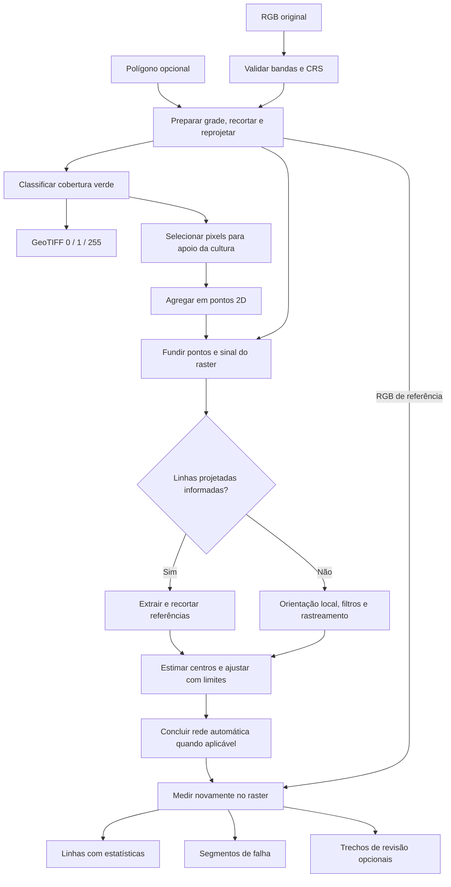

# 00 — Arquitetura e fluxo completo

[Índice](README.md) · Fontes: [inicialização](../__init__.py), [plugin](../Falhadeplantio.py), [provedor](../Falhadeplantio_provider.py).

## Inicialização no QGIS

1. O QGIS lê `metadata.txt` e chama `classFactory(iface)`.
2. A fábrica importa e devolve `FalhaDePlantioPlugin`. O argumento `iface` não é usado para criar uma janela própria.
3. `initGui()` chama `initProcessing()`.
4. O plugin cria `FalhaDePlantioProvider` e o registra em `QgsApplication.processingRegistry()`.
5. `loadAlgorithms()` registra as duas classes de processamento. Os diálogos são gerados pelos parâmetros de `initAlgorithm()`.
6. `unload()` remove o provedor do registro. Não apaga as saídas já criadas no projeto ou em disco.

O identificador do provedor é `falhadeplantio`. As operações públicas são:

| Identificador Processing | Classe |
| --- | --- |
| `falhadeplantio:classificar_vegetacao_rgb` | `FalhaDePlantioAlgorithm` |
| `falhadeplantio:restituir_linhas_plantio` | `RestituirLinhasAlgorithm` |

O `longName()` do provedor ainda contém a string histórica `v2.3`. A versão declarada para esta documentação é a de `metadata.txt`, 2.6; essa string visual não seleciona um algoritmo diferente.

## Fluxo de dados

O RGB recortado alimenta a primeira classificação e os pontos **na mesma execução**. A restituição é uma segunda operação: o usuário seleciona o RGB de referência e a nuvem, podendo informar o projeto de plantio.

## Responsabilidade de cada módulo

| Arquivo | Responsabilidade |
| --- | --- |
| `Falhadeplantio_algorithm.py` | Preparar RGB, recortar, classificar e gerar pontos |
| `RestituirLinhasAlgorithm.py` | Coordenar grades, rastreamento, referências, ajuste e gravação final |
| `cane_centers.py` | Estimar núcleos visíveis, contexto de apoio e deslocamentos suaves |
| `row_network.py` | Recortar pela validade, conectar fragmentos, completar fileiras e registrar referências |
| `planting_gaps.py` | Amostrar o raster e transformar evidência em estados e intervalos métricos |

QGIS fornece camadas, CRS, geometrias, sinks e contexto; GDAL fornece leitura, VRT, reprojeção e GeoTIFF; NumPy/SciPy fornecem operações matriciais, morfologia, FFT, árvores espaciais e sistemas esparsos. A implementação não chama GRASS GIS ou PDAL para executar essas duas operações.

## Duas resoluções, dois usos

A restituição usa uma **grade de análise** relativamente grosseira para orientação e geometria. A medição final cria outro amostrador sobre o raster de referência, com detalhe limitado pela resolução efetiva. A máscara dilatada usada para rastrear não é a fonte final do comprimento das falhas.

## Contratos de execução

Cada algoritmo recebe `parameters`, `context` e `feedback`, resolve entradas, valida pré-condições, processa e retorna um dicionário de destinos. `context` resolve camadas e transformações; `feedback` recebe progresso, mensagens e cancelamento.

Saídas vetoriais usam `QgsFeatureSink`; por isso um destino pode ser temporário ou persistente, conforme a execução do QGIS. O texto do rótulo “GeoPackage” não força todo sink temporário a se tornar um arquivo `.gpkg`.
