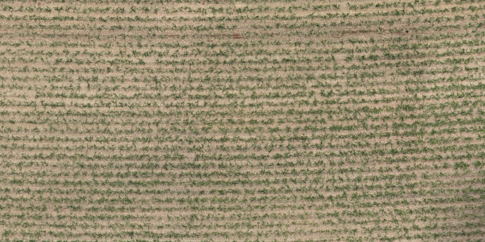
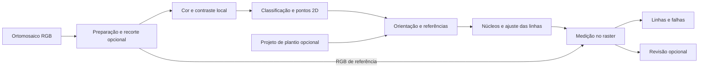
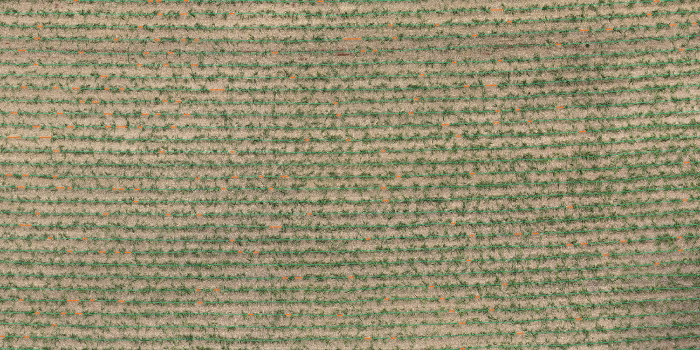
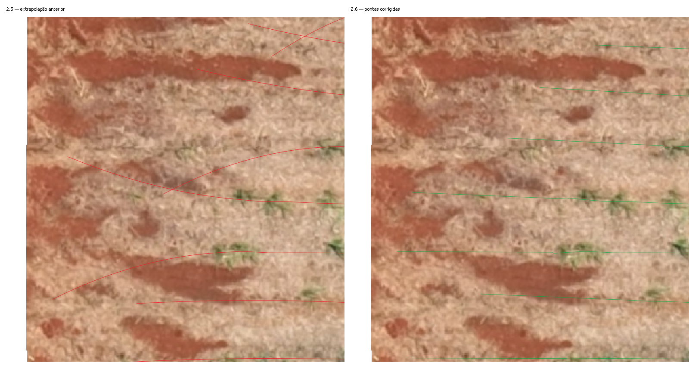
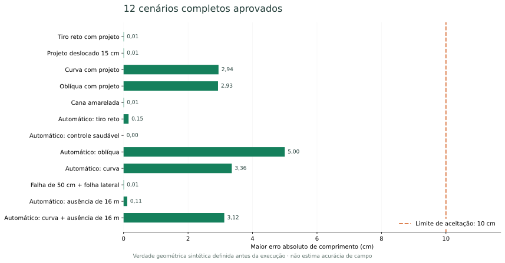
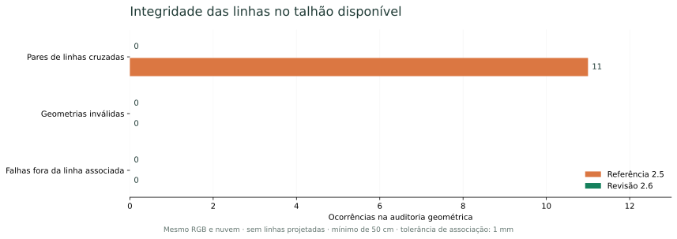
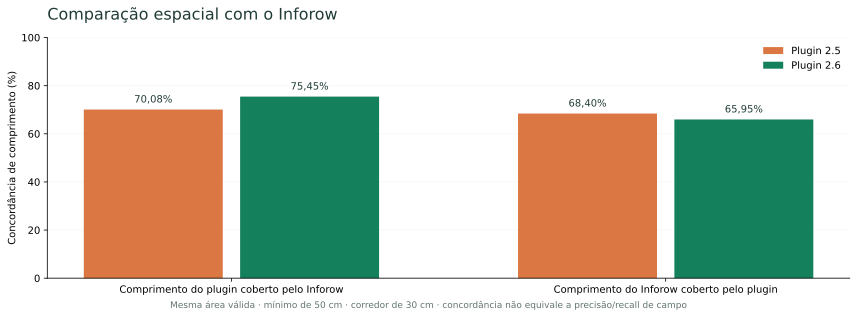

<div align="center">
  <h1>Falha de Plantio para QGIS</h1>
  <p><strong>Do ortomosaico RGB às linhas de plantio e aos segmentos de falha.</strong></p>
  <p>Análise de cobertura vegetal e restituição de fileiras de cana-de-açúcar, com rastreabilidade das decisões e revisão de trechos incertos.</p>
  <p><a href="#instalacao">Instalação</a> · <a href="#fluxo-de-uso">Começar a usar</a> · <a href="DOCS/README.md">Documentação técnica</a> · <a href="#validacao">Validação</a></p>
</div>



*Imagem de referência do conjunto utilizado na auditoria. As figuras deste README foram renderizadas a partir dos dados e resultados da sessão de validação; não são imagens geradas por IA.*

| Versão documentada | QGIS mínimo declarado | Ambiente QGIS validado | Verificação funcional |
| :---: | :---: | :---: | :---: |
| **2.6** | **3.22** | **3.44.11** | **93 regressões · 12 cenários** |

> Os números de testes descrevem a bateria executada nesta revisão. Não representam uma taxa universal de acurácia agronômica.

## Índice

- [Visão geral](#visao-geral)
- [O que o plugin entrega](#entregas)
- [Instalação e requisitos](#instalacao)
- [Fluxo de uso](#fluxo-de-uso)
- [Como a análise funciona](#metodologia)
- [Exemplos visuais](#exemplos)
- [Validação e resultados](#validacao)
- [Interpretar as saídas](#interpretacao)
- [Documentação técnica](#documentacao)
- [Referências e desenvolvimento](#referencias)

<a id="visao-geral"></a>
## Visão geral

O **Falha de Plantio** é um plugin de processamento para QGIS voltado à análise de cana-de-açúcar em ortomosaicos RGB. O fluxo combina índices de cor, contraste espacial, morfologia vegetal e geometria de fileiras para:

1. preparar a imagem, com recorte e reprojeção opcionais;
2. classificar cobertura verde e gerar pontos representativos da cultura;
3. restituir linhas retas ou curvas, com ou sem projeto de plantio;
4. medir intervalos de ausência ao longo das linhas;
5. separar falhas confirmadas, trechos incertos e dados indisponíveis.

As duas ferramentas ficam na **Caixa de Ferramentas de Processamento → Falha de Plantio (Cana-de-açúcar) → Análise de falhas**.

<a id="entregas"></a>
## O que o plugin entrega

| Resultado | Conteúdo | Uso principal |
| --- | --- | --- |
| **Classificação de vegetação** | GeoTIFF com classes 0, 1 e NoData | Inspecionar a cobertura verde detectada |
| **Nuvem de pontos da cultura** | Pontos 2D agregados espacialmente | Apoiar a identificação das fileiras |
| **RGB preparado** | Imagem recortada e reprojetada, no modo com máscara | Reutilizar a mesma referência na restituição |
| **Linhas restituídas** | Geometria, origem e estatísticas por parte | Representar a continuidade estimada do plantio |
| **Segmentos de falha** | Intervalos que atingem o mínimo configurado | Localizar e quantificar as ausências detectadas |
| **Camada de revisão** | Trechos incertos ou sem dados | Conferir regiões sem conclusão suficiente |

A nuvem é uma representação 2D de pixels agregados. Um ponto não equivale necessariamente a um pé de cana, e o centro visível de uma touceira não comprova a posição de um colmo oculto.

<a id="instalacao"></a>
## Instalação e requisitos

**Requisitos de análise:** QGIS com GDAL, NumPy e SciPy disponíveis no seu ambiente Python.

O mínimo declarado em `metadata.txt` é QGIS 3.22. A validação desta revisão foi executada com **QGIS 3.44.11, Python 3.12.13 e GDAL 3.13.0**, no Windows.

### Instalar por pacote ZIP

1. No QGIS, abra **Complementos → Gerenciar e Instalar Complementos**.
2. Selecione **Instalar a partir de ZIP** e informe o pacote de instalação do plugin.
3. Ative **Falha de Plantio**.
4. Abra a Caixa de Ferramentas de Processamento e localize o provedor.

### Instalar a partir do código-fonte

```bash
git clone https://github.com/CainC0de/Analise-de-falha-QGIS.git
```

Copie a pasta do plugin para o diretório de complementos do perfil QGIS. No Windows, o caminho usual é:

```text
%APPDATA%\QGIS\QGIS3\profiles\<perfil>\python\plugins\Falhadeplantio\
```

Os arquivos `metadata.txt` e `__init__.py` devem estar diretamente nessa pasta. Ative o complemento ou reinicie o QGIS após substituir uma instalação existente.

Os gráficos e a documentação têm ferramentas de geração próprias; Matplotlib é utilizado para recriar as figuras, não pelo algoritmo de análise.

<a id="fluxo-de-uso"></a>
## Fluxo de uso

### 1. Preparar a imagem e gerar a nuvem

Abra **Classificar vegetação verde (RGB)**.

| Opção | Quando usar | Configuração |
| --- | --- | --- |
| **Usar o raster diretamente** | A imagem já cobre a área desejada | Selecione RGB, bandas, resolução e espaçamento dos pontos |
| **Recortar pelo polígono do talhão e processar** | Deseja restringir o processamento ao talhão | Informe também o polígono e, se necessário, o CRS métrico de saída |

No segundo modo, o RGB recortado e reprojetado alimenta a classificação e a nuvem **na mesma execução**. Partes separadas e buracos da máscara são respeitados. O RGB preparado fica disponível para a etapa seguinte.

**Configuração inicial:** bandas R/G/B = 1/2/3, pixel solicitado = 5 cm, agregação de pontos = 20 cm e sensibilidade = 0. A resolução efetiva é limitada pelo detalhe disponível na fonte.

### 2. Restituir as linhas e medir as falhas

Abra **Restituir linhas de plantio a partir dos pontos** e informe:

- o **RGB original ou preparado** como imagem de referência;
- a **nuvem de pontos da cultura**;
- a **entrelinha esperada**, por exemplo, 1,5 m;
- o **tamanho mínimo de falha em centímetros**, por exemplo, 50 cm;
- a camada de **linhas projetadas**, se houver.

**Sem projeto**, o plugin estima orientação local, rastreia fileiras e completa sua geometria apenas quando encontra apoio compatível. **Com projeto**, as linhas externas fornecem referência também para regiões vazias, com ajuste condicionado à evidência disponível.

Mantenha o refinamento de solo visível ativado para avaliar ausências apoiadas no RGB. Ative a saída **Trechos incertos ou sem dados para revisão** quando precisar conferir regiões não avaliadas.

### 3. Conferir e salvar

Compare as falhas sobre o RGB. Examine `origem`, `incerto_m`, `sem_dados_m` e a camada de revisão antes de interpretar os percentuais. Salve os resultados temporários que precisam ser preservados.

**O mínimo de falha e a maior lacuna de rastreamento são parâmetros diferentes.** O primeiro filtra o comprimento final dos segmentos; o segundo controla a continuidade da busca geométrica.

<a id="metodologia"></a>
## Como a análise funciona



| Etapa | Decisão principal | Explicação técnica |
| --- | --- | --- |
| Cobertura verde | Combina GLI, NGRDI e contraste com o fundo local | [Classificação RGB](DOCS/03_CLASSIFICACAO_RGB.md) |
| Pontos | Agrega pixels de apoio em células e calcula centroides | [Nuvem de pontos](DOCS/04_NUVEM_DE_PONTOS.md) |
| Orientação | Analisa periodicidade local por FFT e filtros direcionais | [Grades e fusão](DOCS/05_GRADES_FUSAO_ORIENTACAO.md) |
| Centralização | Prioriza núcleos visíveis e limita pequenas flexões | [Centros e ajuste](DOCS/07_CENTROS_E_AJUSTE.md) |
| Continuidade | Usa contexto, vizinhas observadas e restrições de conflito | [Rede de linhas](DOCS/08_CONTINUIDADE_E_PROJECOES.md) |
| Falhas | Classifica o perfil como presença, ausência, incerteza ou falta de dados | [Identificação de falhas](DOCS/09_IDENTIFICACAO_DE_FALHAS.md) |

A geometria e a presença de cultura são decisões separadas. Uma linha pode atravessar um intervalo vazio; a máscara dilatada usada para rastrear não é a fonte final do comprimento das falhas.

<a id="exemplos"></a>
## Exemplos visuais

### Linhas automáticas e segmentos de falha



**Verde:** linhas restituídas. **Laranja:** intervalos identificados como falha, com mínimo de 50 cm. O exemplo foi gerado sem linhas projetadas. A figura mostra a saída computacional, não uma anotação independente de verdade de campo.

### Correção das extremidades



A revisão 2.6 substitui a extrapolação quadrática individual das pontas por uma tendência linear observada e verifica conflitos de continuidade. Neste local da auditoria, isso removeu os cruzamentos provocados pela extensão anterior.

[Origem e reprodução das figuras](DOCS/imagens/README.md).

<a id="validacao"></a>
## Validação e resultados

### Ensaios funcionais controlados

A revisão documentada passou por **93 testes de regressão** e **12 cenários completos**. Os cenários incluem tiro reto, curvas, direção oblíqua, projeto deslocado, cana amarelada, controle saudável, folha lateral sobre falha curta e ausências de 16 m sem projeto.



O maior erro de comprimento observado nessa matriz foi de aproximadamente **5 cm**, com limite de aceitação de 10 cm. Esse resultado se refere aos ensaios definidos, não à precisão de qualquer imagem de entrada.

### Auditoria do talhão disponível

As execuções de referência 2.5 e revisão 2.6 usaram o mesmo RGB e a mesma nuvem, sem linhas projetadas e com mínimo de 50 cm.



| Verificação | Referência 2.5 | Revisão 2.6 |
| --- | ---: | ---: |
| Linhas geradas | 241 | 241 |
| Pares de linhas cruzadas | 11 | **0** |
| Geometrias inválidas | 0 | 0 |
| Falhas fora da linha associada, tolerância de 1 mm | 0 | 0 |

A reversão da leitura das mesmas coordenadas em 20 fileiras não alterou nenhuma classe. Esses controles verificam execução e integridade; não certificam cada falha como agronomicamente correta.

### Comparação com Inforow



A comparação usa a mesma área válida, mínimo de 50 cm e corredor de 30 cm. A concordância aumentou em um sentido e diminuiu no outro. **Quantidade de segmentos e concordância entre programas não equivalem a precisão ou recall de campo.**

Consulte a [auditoria completa da 2.6](AUDITORIA_FALHAS_2_6.md), o [protocolo de testes](DOCS/12_TESTES_E_REPRODUCAO.md) e os [dados agregados dos gráficos](DOCS/dados/validacao_2_6.json).

<a id="interpretacao"></a>
## Interpretar as saídas

| Informação | Interpretação correta |
| --- | --- |
| Raster `1` | Cobertura verde detectada |
| Raster `0` | Verde não detectado pela primeira classificação |
| Raster `255` | NoData |
| `falha_m` | Soma de ausências que atingem o mínimo |
| `falha_pct` | Percentual sobre o comprimento efetivamente avaliado |
| `incerto_m` / `sem_dados_m` | Comprimentos excluídos desse denominador |
| `pct_pes` / `pct_proj` | Apoio e proteção usados na geometria; não são contagem de plantas |
| `origem` | Distingue projeto, observação, conexão e inferência |
| `evidencia` | Identifica o método que contribuiu para o segmento de falha |

As categorias incluem falha **interna**, **inicial**, **final**, **total**, **limite_dados** e **limite_incerto**. A descrição de cada campo e das regras de comprimento está em [Comprimentos e saídas](DOCS/10_COMPRIMENTOS_CATEGORIAS_SAIDAS.md).

**Limites de observação:** RGB não comprova presença ou ausência de colmos sob folhas sobrepostas. Dossel fechado, invasoras, sombra, resolução insuficiente e falta de referência geométrica podem exigir revisão. Percentual zero com grande comprimento incerto não comprova ausência de falhas.

<a id="documentacao"></a>
## Documentação técnica

A pasta **[`DOCS`](DOCS/README.md)** descreve o fluxo atual, as fórmulas, os parâmetros, os limiares, os fallbacks e a gravação dos resultados.

| Quero entender… | Documento |
| --- | --- |
| O fluxo completo e os módulos | [Arquitetura](DOCS/00_ARQUITETURA_E_FLUXO.md) |
| Cada entrada e sua unidade | [Parâmetros e CRS](DOCS/01_ENTRADAS_PARAMETROS_CRS.md) |
| O recorte e a reprojeção | [Preparação do raster](DOCS/02_PREPARACAO_RECORTE_RASTER.md) |
| O modo sem linhas projetadas | [Rastreamento](DOCS/06_RASTREAMENTO_DAS_LINHAS.md) |
| Por que uma região virou falha ou revisão | [Identificação de falhas](DOCS/09_IDENTIFICACAO_DE_FALHAS.md) |
| Recursos, cancelamento e mensagens de erro | [Operação e diagnóstico](DOCS/11_RECURSOS_CANCELAMENTO_ERROS.md) |
| Onde cada função está implementada | [Mapa de 78 funções e métodos](DOCS/13_MAPA_DO_CODIGO.md) |

<details>
<summary><strong>Estrutura do repositório</strong></summary>

```text
├── Falhadeplantio.py                 # ciclo de vida no QGIS
├── Falhadeplantio_provider.py        # registro dos algoritmos
├── Falhadeplantio_algorithm.py       # preparação, classificação e pontos
├── RestituirLinhasAlgorithm.py       # coordenação da restituição e saídas
├── cane_centers.py                   # núcleos e ajuste dos centros
├── row_network.py                    # continuidade e inferência geométrica
├── planting_gaps.py                  # estados e intervalos de falha
├── scripts/                         # validação e figuras da documentação
├── test/                            # regressões e cenários
└── DOCS/                            # guias, imagens e métricas agregadas
```

</details>

<a id="referencias"></a>
## Referências e desenvolvimento

As abordagens consultadas incluem análise por objetos, segmentação de vegetação, morfologia e geometria de fileiras. Os limiares do plugin são uma implementação própria; os resultados publicados abaixo não são automaticamente transferidos a este código.

- Souza et al. — *Mapping skips in sugarcane fields using object-based image analysis*. [DOI](https://doi.org/10.1016/j.compag.2017.10.006).
- Rocha et al. — *Automatic detection and evaluation of sugarcane planting rows in aerial images*. [DOI](https://doi.org/10.1016/j.inpa.2022.04.003).
- Junqueira et al. — *Mapping Gaps in Sugarcane by UAV RGB Imagery: The Lower and Earlier the Flight, the More Accurate*. [Artigo](https://www.mdpi.com/2073-4395/11/12/2578).
- Maldaner et al. — *Identification and measurement of gaps within sugarcane rows for site-specific management*. [DOI](https://doi.org/10.1016/j.biosystemseng.2021.06.016).

Para relatar um problema, informe versão do plugin/QGIS, parâmetros, CRS, resolução do RGB e um recorte que permita reproduzir o caso. Inclua o log de processamento e, quando relevante, a camada de revisão.

[Reportar problema](https://github.com/CainC0de/Analise-de-falha-QGIS/issues) · [Código-fonte](https://github.com/CainC0de/Analise-de-falha-QGIS) · [Histórico técnico de validação](VALIDACAO.md)

---

Mantido por **CainC0de**. Documentação e figuras referentes à revisão **2.6**, auditada em **6 de novembro de 2026**.
